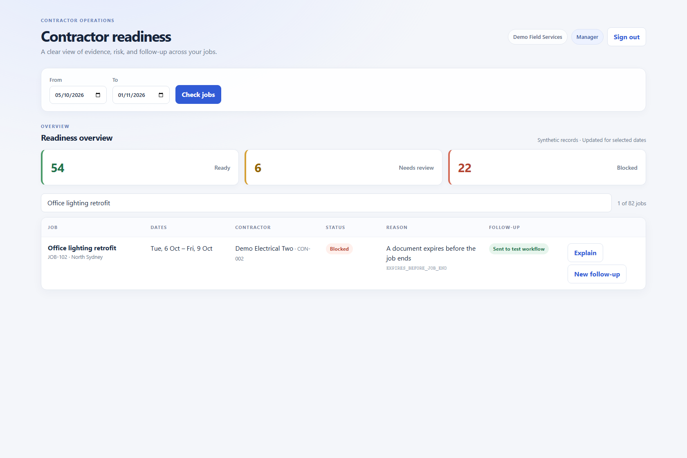
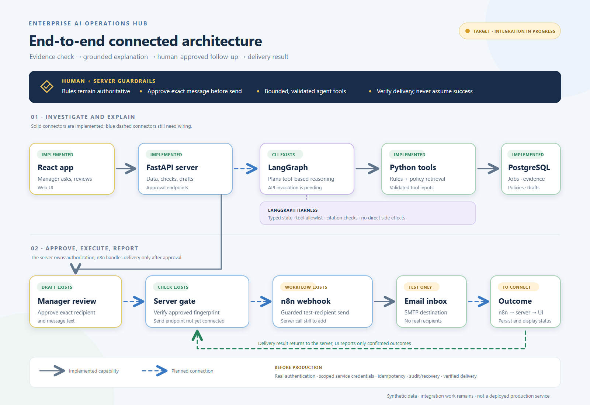
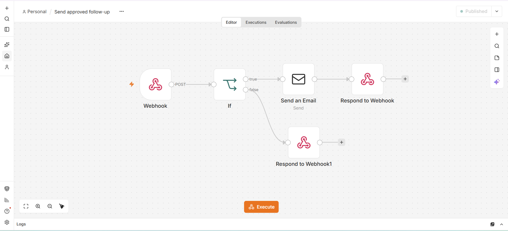

# Contractor Evidence & Readiness Operations Hub

**Operational decision support for contractor evidence and controlled follow-up.**

This client-evaluation prototype demonstrates how an operations manager can review job readiness, understand evidence gaps against a company procedure, and prepare an approved contractor follow-up. It is inspired by the contractor-management domain; it is not an official FocusIMS or FocusBIS product, integration, or endorsement.

All organisations, people, jobs, policies, and documents shown here are synthetic. The current build is intended for local demonstration and workflow evaluation—not production use. Business fit, client value, and integration compatibility require validation with authorised stakeholders.

## Product Preview

The dashboard brings readiness counts, job-level reasons, and follow-up delivery state together. The screenshot highlights the JOB-102 example.



## Demonstrated Capabilities

- **Evidence readiness:** deterministic rules assess required contractor documents against job dates and policy thresholds; PostgreSQL stores operational records.
- **Operational dashboard:** FastAPI-backed assessments with date filtering, search, status counts, job explanations, and follow-up state.
- **Procedure-grounded explanations:** FastAPI invokes the LangGraph workflow, retrieves applicable policy passages, and validates citations against the retrieved source.
- **Controlled follow-up:** managers review and edit a draft, approve the exact text, then dispatch through an authenticated n8n webhook to a local test inbox. Delivery status is separate from readiness status.
- **Authentication boundary:** local-only development sign-in and Hellō OIDC with signed FastAPI sessions and organisation membership/role checks are implemented. Full production-grade tenant isolation and security review remain outstanding.

### End-to-end flow



The architecture and workflow diagrams describe the [LangGraph reasoning path](docs/langgraph-ai-flow.svg) and [n8n follow-up path](docs/n8n-followup-workflow.svg). The n8n workflow has been locally exercised with Mailpit; the architecture is not a deployed production service or customer integration.

### n8n Workflow Editor

The screenshot below shows the published local workflow canvas used for the approved test follow-up path.



## Example Use Case

For **JOB-102**, the dashboard reports that insurance evidence expires before the assigned job ends. The manager can request an explanation grounded in the applicable synthetic procedure, prepare a message asking for coverage for the full job period, review and approve the exact text, and send it to the local test workflow. A successful workflow execution does not itself verify that a contractor received or acted on a message.

See [workflow scope and assumptions](docs/WORKFLOW.md), [knowledge sources](docs/knowledge/README.md), and [public-product research](docs/FOCUSIMS_RESEARCH.md).

## Run the Local Demonstration

Requires Python 3.11, Docker Desktop, and Node.js 20.19+. From the project folder, in CMD:

```cmd
py -3.11 -m venv .venv
.venv\Scripts\activate.bat
python -m pip install -r requirements.txt -r requirements-dev.txt
copy .env.example .env

docker compose up -d
python -m alembic upgrade head
python seed.py
fastapi dev api.py
```

Configure database credentials, the model API key, and a random `SESSION_SECRET` in `.env`. In a second terminal:

```cmd
cd web
npm install
npm run dev
```

Open http://localhost:5173 and select **Enter local demo**. The development sign-in is disabled outside `APP_ENV=development`; Hellō is not required for the local walkthrough. API documentation is available at http://127.0.0.1:8000/docs. Database seeding resets synthetic records; `python seed.py --small` loads only the four fixed example jobs.

To exercise the approved follow-up path, configure `N8N_FOLLOWUP_WEBHOOK_URL` and `N8N_FOLLOWUP_WEBHOOK_TOKEN` using the [test delivery setup](docs/followup-delivery.md). Keep the recipient guard and test SMTP inbox in place; do not configure real recipients or production SMTP.

The separate graph CLI is available with `python readiness_graph.py "Why is JOB-102 blocked?"`; model requests may incur cost.

## Delivery Roadmap

1. **Security hardening:** complete CSRF protection, verify organisation scoping across every data path, review session/cookie settings, and add audited user provisioning.
2. **Reliability and evaluation:** test duplicate and partial-failure scenarios, measure explanation accuracy/citation support, and add monitoring and recovery procedures.
3. **Stakeholder validation:** confirm the target workflow, authoritative evidence fields, procedure ownership, and integration permissions with the relevant business stakeholders.
4. **Deployment readiness:** only after the previous gates, define a supported hosting, backup, release, and incident-response model.

Manual operator reconciliation is implemented for unknown n8n outcomes. Automated execution lookup and operational alerts remain future work.

For the current implementation state and acceptance criteria, see the [delivery plan](PROJECT_PLAN.md). Authentication and integration details are documented in [Hellō setup](docs/authentication.md) and [follow-up delivery](docs/followup-delivery.md).

## Current Boundaries

- Synthetic records and illustrative procedures only; no live client data or approved company policy is included.
- Readiness is not a legal, safety, ISO compliance, or permission-to-work verdict.
- Follow-up delivery is restricted to test recipients and a local capture inbox.
- Hellō login is wired, but production-grade tenant isolation, CSRF protection, audited provisioning, and operational recovery are not complete.
- No FocusIMS/FocusBIS API, customer environment, or production email integration is configured.

These boundaries are explicit so a client can assess the concept without mistaking a prototype for a production-ready service.
