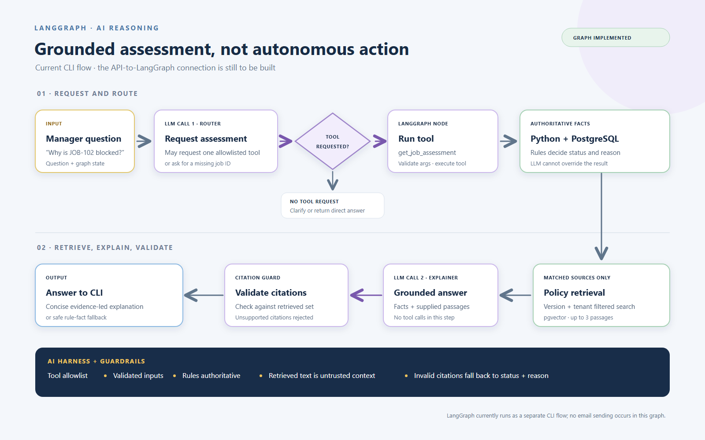

# Enterprise AI Operations Hub

Learn to build an AI application from end to end, one working step at a time.

## Business focus

**Contractor Evidence and Audit Preparation Assistant**, inspired by the FocusIMS supplier-management domain. The primary user is an operations manager at a trade or maintenance business. FocusBIS consultants preparing contractor evidence for review are a secondary potential audience.

The target question is: **“Why is JOB-102 blocked, which company procedure applies, and what should we request from the contractor?”**

FocusIMS already describes contractor-document management. Our proposed contribution connects conversational investigation, operational facts, procedure citations and approved follow-ups. This is an independent synthetic prototype, not an official product or integration. Client value and integration compatibility remain unvalidated. See the [public-product research](docs/FOCUSIMS_RESEARCH.md).

### Current capabilities

- Implemented: readiness rules, PostgreSQL records, API/browser assessments, a LangGraph explanation endpoint with policy retrieval and citation checks, a local-only demo sign-in, and saved follow-up drafts with exact-text approval records.
- Manually demonstrated: JOB-102 explanation, missing job-ID clarification and unknown-job handling.
- Still to connect: the post-approval server gate to the n8n webhook and delivery-status handling.
- Added: local-only demo access for development, plus Hellō authorization-code login with PKCE, signed FastAPI sessions, and server-side organisation membership/role checks for deployment. The local demo bypasses external identity setup and is disabled outside `APP_ENV=development`; see [authentication setup](docs/authentication.md).
- Before production: audited user provisioning, CSRF protection, complete tenant-data isolation, idempotent execution, reliable delivery reconciliation, audit and recovery controls.

The graph is called through FastAPI, which passes the organisation from the authenticated session to its tools; the separate CLI remains for local exploration. Document readiness is not an ISO compliance verdict or permission to commence work.

See [questions and workflow](docs/WORKFLOW.md) and [knowledge sources and RAG context](docs/knowledge/README.md).

## System architecture


The diagram shows the complete target journey, but predates the new API-to-LangGraph explanation endpoint. The approval-gated API-to-n8n delivery connection remains to be built. This is a project in progress, not a deployed production service or a real customer integration. [Open the SVG](docs/end-to-end-connected-architecture.svg).

### Component flows

The [LangGraph + AI diagram](docs/langgraph-ai-flow.svg) details tool routing, deterministic checks, policy retrieval and citation validation. The [n8n diagram](docs/n8n-followup-workflow.svg) shows its authenticated webhook, test-recipient guard, SMTP step and response branches. Both distinguish existing workflow logic from connections still to build.




See the [animated workflow GIF](docs/contractor-readiness-workflow.gif) and [LinkedIn architecture image](docs/contractor-readiness-production-linkedin.png) for additional visuals.

## Our example

A manager checks fictional jobs and sees which contractors have missing documents. The app can request a LangGraph explanation with procedure passages; saved follow-up drafts can be reviewed and approved. The approval-gated n8n delivery connection remains to be built. Four fixed jobs provide predictable examples; generated records provide a larger dataset.

We use invented data inspired by the FocusIMS business domain. This is an independent learning project; its value to that client is still unvalidated.

## Start here

1. [Today's small exercise](docs/DAY_01.md)
2. [Simple architecture](docs/architecture.md)
3. [Step-by-step plan](PROJECT_PLAN.md)

## Run it locally

Needs Python 3.11 and Docker Desktop. From the project folder, in CMD:

```cmd
py -3.11 -m venv .venv
.venv\Scripts\activate.bat
python -m pip install -r requirements.txt -r requirements-dev.txt
copy .env.example .env

docker compose up -d
alembic upgrade head
python seed.py

python -m pytest
fastapi dev api.py
```

Set database credentials, the model API key, and a random `SESSION_SECRET` in `.env`. In local development, open the web app and choose **Enter local demo**; Hellō setup is not required. PostgreSQL uses port 5433; API docs are at http://127.0.0.1:8000/docs. For a deployed environment, configure Hellō and provision memberships as described in [authentication setup](docs/authentication.md). Seeding resets synthetic records: the default loads fixtures plus generated data; `python seed.py --small` loads only the four fixture jobs.

Run the separate graph with `python readiness_graph.py "Why is JOB-102 blocked?"`. This makes paid model requests.

In a second terminal, the browser page (needs Node.js 20.19+):

```cmd
cd web
npm install
npm run dev
```

Open http://localhost:5173.

## Integration roadmap

Current: React -> FastAPI -> Python rules + PostgreSQL; FastAPI -> LangGraph -> tenant-scoped tools + policy retrieval.

Next: after human approval, FastAPI -> n8n -> test inbox -> recorded delivery outcome.

Hellō login and the API membership boundary are wired for local development. See [Hellō setup and remaining security work](docs/authentication.md); this is not yet a public-deployment-ready service.

Each addition solves a problem you can already see. We will explain the code, run it, and change an example to understand its behavior before adding the next technology.

## Working together

Prioritise understanding and small working changes. Explain unfamiliar terms when they first appear. Teach only what the current step needs. Ask one short understanding question after a demonstration; avoid long homework lists. Discuss meaningful architecture changes, and keep documentation short.

The app uses synthetic records, and the n8n workflow is restricted to test recipients. The approval-to-n8n path is not connected end-to-end yet. Public deployment and real recipients require tenant isolation, CSRF protection, audited provisioning, approval-gated execution, durable audit and recovery controls first.

## Optional references

- [Workflow](docs/WORKFLOW.md)
- [Learning approach](docs/LEARNING_PATH.md)
- [Short decision summary](docs/decisions/README.md)
- [FocusIMS research](docs/FOCUSIMS_RESEARCH.md)
- [Preserved detailed plan](docs/archive/advanced-baseline/PROJECT_PLAN.md)
